# Kansabooj


> **Dépôt principal : [git.k3nny.fr/k3nny/kansabooj](https://git.k3nny.fr/k3nny/kansabooj).**
> [github.com/k3nnyfr/kansabooj](https://github.com/k3nnyfr/kansabooj) n'en est qu'un miroir en lecture seule, mis à jour automatiquement : les issues et contributions se font sur le dépôt principal.

Kansabooj (« quand ça bouge ») surveille les **contrats d'API** dont dépend votre API Gateway : APIs de partenaires réexposées en interne, ou APIs internes entre équipes. Il relit régulièrement chaque contrat (OpenAPI, Swagger, page Swagger-UI ou Redoc, et même une simple page HTML), détecte ce qui a changé, signale ce qui casse dans le périmètre que vous réexposez, garde l'historique et prévient les équipes sur Google Chat, Slack, Teams ou un webhook.

**[Démo en ligne](https://kansabooj.k3nny.fr/)** · **[Architecture](docs/ARCHITECTURE.md)** · **[Dépôt](https://git.k3nny.fr/k3nny/kansabooj)** ([miroir GitHub](https://github.com/k3nnyfr/kansabooj)) · **[Feuille de route](docs/ROADMAP.md)** · **[Décisions (ADR)](docs/adr/)** · **[API REST](backend/internal/httpapi/openapi.yaml)** · Licence [MIT](LICENSE)

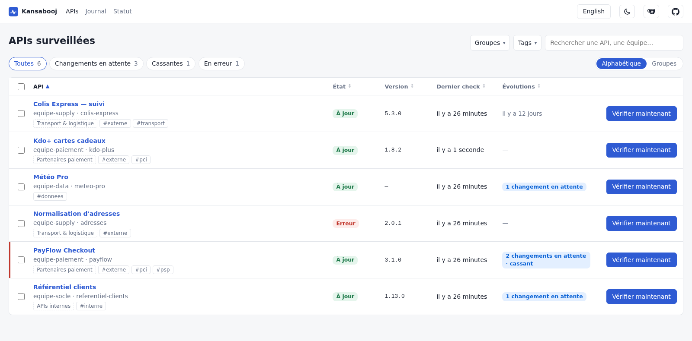

## Pourquoi

Un partenaire publie une nouvelle version de son API : un paramètre devient obligatoire, un champ disparaît d'une réponse. Personne n'est prévenu, et l'on découvre la rupture en production, à travers la Gateway. Kansabooj fait ce travail de veille à la place des équipes. Il ne signale que les **vrais changements de contenu** : un contrat réordonné, republié en YAML au lieu de JSON, ou dont seuls les champs que vous déclarez comme bruit ont bougé (serveurs, dates de génération…) est considéré comme identique. Chaque changement est ensuite classé avec [oasdiff](https://github.com/oasdiff/oasdiff), en distinguant ce qui touche **les opérations que vous réexposez** de tout le reste.

## Ce que fait Kansabooj

| Fonction | Ce qu'elle permet |
|---|---|
| **Sources** | OpenAPI 3.0 et 3.1, Swagger 2.0 (converti), JSON ou YAML, specs réparties en plusieurs fichiers (`$ref` externes). Derrière une page de documentation, la spec est retrouvée automatiquement : Swagger-UI, springdoc, Redoc, ou emplacements usuels. |
| **Détection** | Version, opérations, paramètres, schémas de requête et de réponse ; chaque changement est classé **cassant**, **à surveiller** ou **info**. Les champs bruyants (`servers`, descriptions…) peuvent être ignorés par règle. |
| **Périmètre réexposé** | `exposed_operations` liste ce que la Gateway publie : un changement hors de ce périmètre est montré à part et peut ne pas notifier. |
| **Mode dégradé** | Une documentation en HTML seul est suivie par son texte visible (sans menus ni pied de page) ; les lignes ajoutées ou retirées sont montrées, à vérifier à la main. |
| **Historique** | Chaque version distincte est conservée (spec brute et normalisée) ; la timeline de chaque API montre les évolutions, qui les a vues et quand. |
| **Comparaison** | Deux versions quelconques d'une API comparées dans l'interface : changements classés, et specs normalisées côte à côte. |
| **Documentation** | Rendu Swagger UI de la dernière version ou de n'importe quelle version conservée, aux couleurs de l'interface ; en lecture seule, aucun appel n'est envoyé aux APIs surveillées. |
| **Notifications** | Google Chat, Slack, Teams, webhook générique signé HMAC ; filtrées par niveau et par périmètre, abonnements par groupe ou par tag, envoi idempotent avec relances. Au choix, un message par changement ou un récapitulatif quotidien ou hebdomadaire (les ruptures pouvant partir tout de suite). |
| **Groupes et tags** | Regrouper les APIs par domaine ou par équipe, avec héritage des réglages (API > groupe > valeurs par défaut). |
| **Accès authentifiés** | Clé d'API, basic, bearer, OAuth2 *client credentials*, mTLS ; les identifiants ne partent jamais vers un autre hôte que celui configuré. |
| **As-code** | La configuration est un fichier YAML versionné (avec JSON Schema pour l'autocomplétion). Chaque équipe peut maintenir son propre fragment, validé en CI par le serveur. |
| **Contrôle de contrat en CI** | `kansabooj diff` compare la spec produite par un build à la version connue, et échoue sur une rupture dans le périmètre réexposé. |
| **Journal** | Checks manuels (avec leur auteur) et planifiés, acquittements, notifications envoyées ou en échec ; filtrable par type et par API. |
| **Interface** | Français ou anglais, y compris le détail de chaque changement ; thème clair ou sombre ; filtres combinables par état, groupes et tags (sélection multiple), vue alphabétique ou par groupe, colonnes triables et en-têtes fixes, vérification à la demande, actions groupées (vérifier, marquer comme vu), page de statut. |
| **Exploitation** | Métriques Prometheus, rechargement de la configuration à chaud, plusieurs réplicas avec élection d'un leader, image sans état en lecture seule. |

## Aperçu

| | |
|---|---|
| 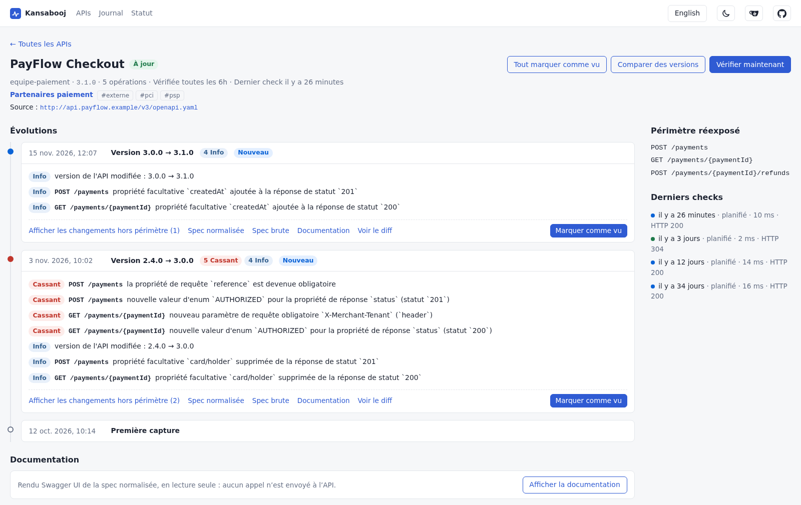 | 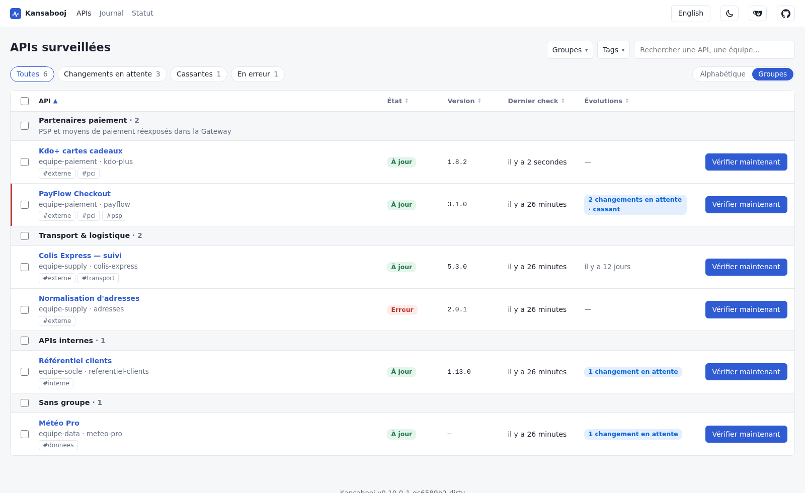 |
| **Fiche d'une API** : timeline des versions, changements cassants dans le périmètre réexposé, liens vers les specs | **Groupes** : les APIs par domaine, avec leur équipe et leurs tags |
| 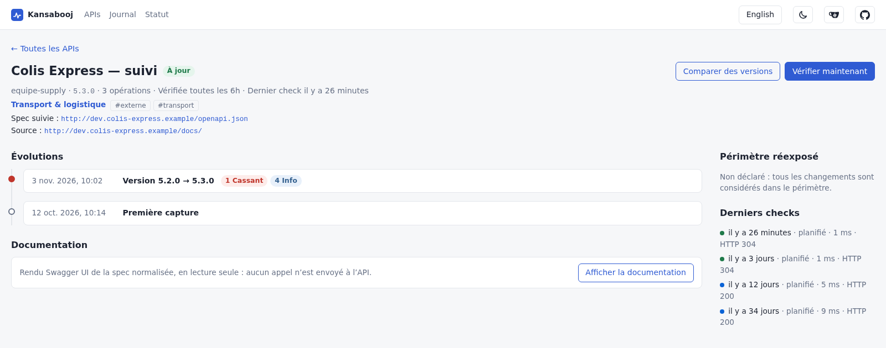 | 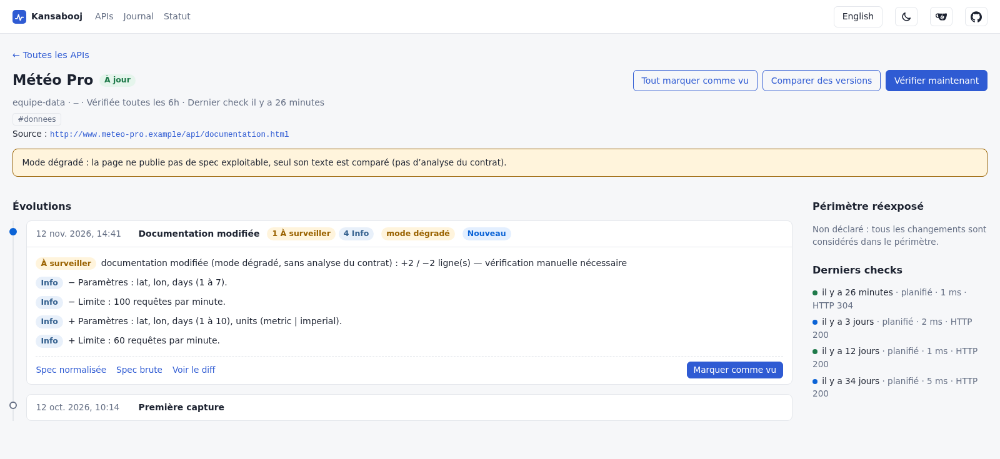 |
| **Découverte** : l'adresse donnée est une page Swagger-UI, la spec suivie est retrouvée derrière | **Mode dégradé** : une page HTML sans spec, comparée ligne à ligne |
| 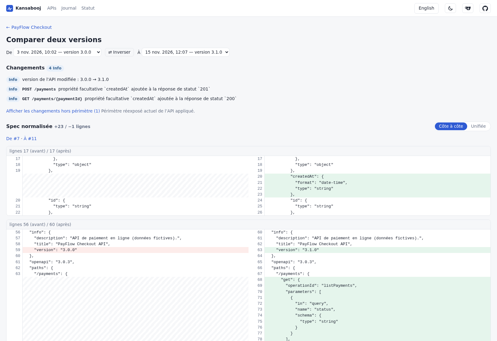 | 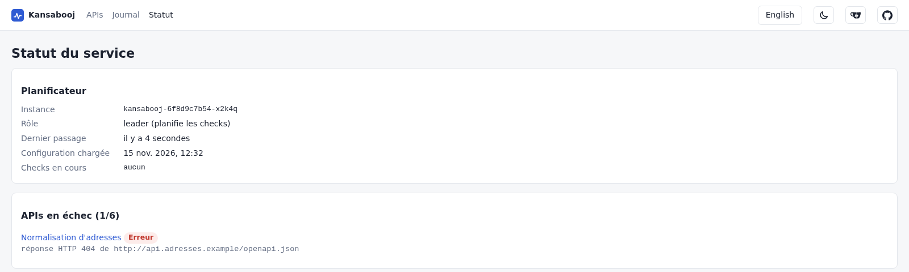 |
| **Comparaison** : deux versions au choix, changements classés et diff côte à côte | **Statut** : rôle de l'instance, APIs en échec et prochains checks |
| 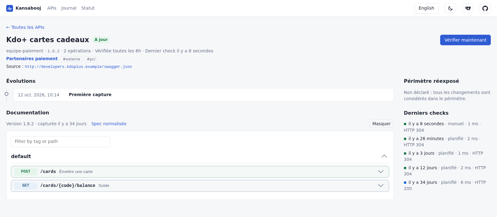 | 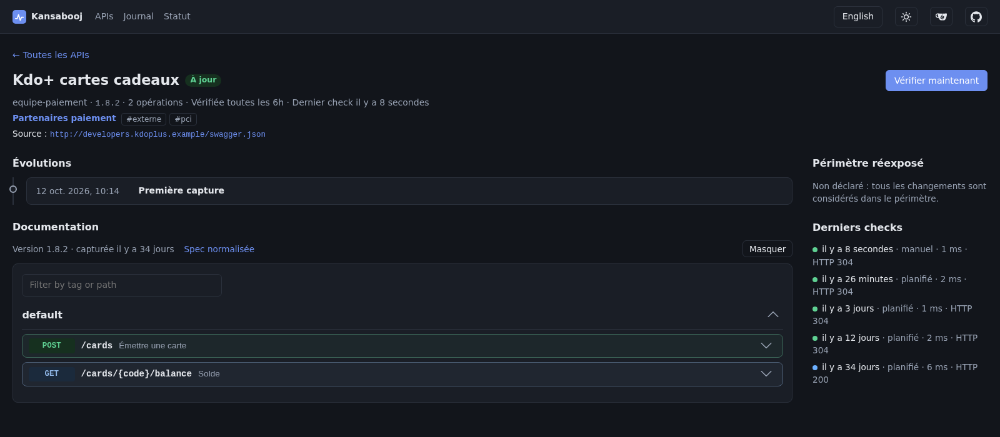 |
| **Documentation** : rendu Swagger UI de n'importe quelle version conservée, en lecture seule | … aux couleurs de l'interface, thème sombre compris |
| 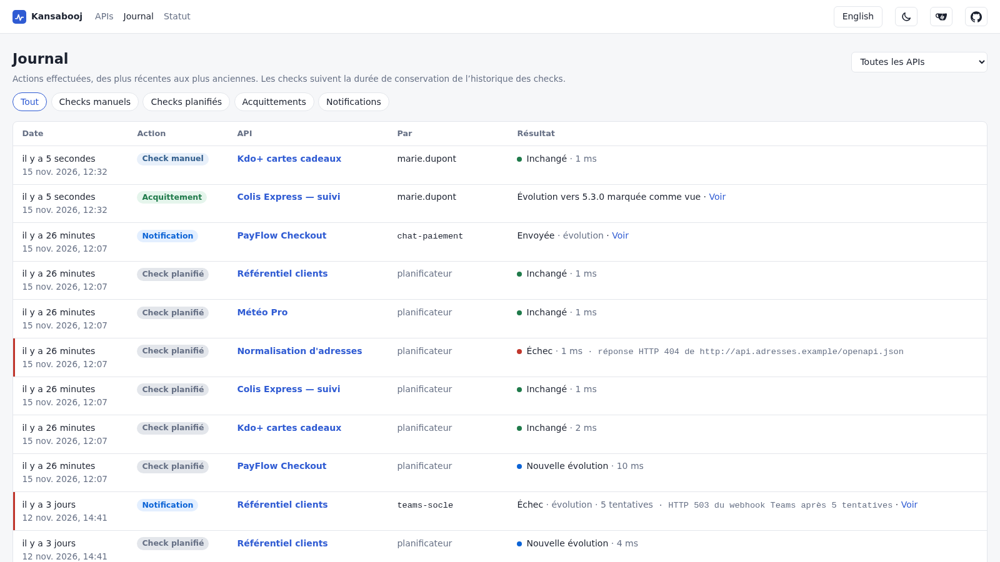 | 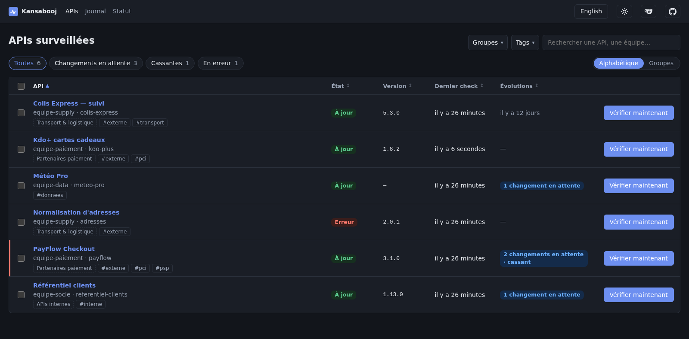 |
| **Journal** : qui a vérifié ou acquitté quoi, et ce que sont devenues les notifications | **Thème sombre** : suit le système, ou choisi avec le bouton en haut à droite |
| 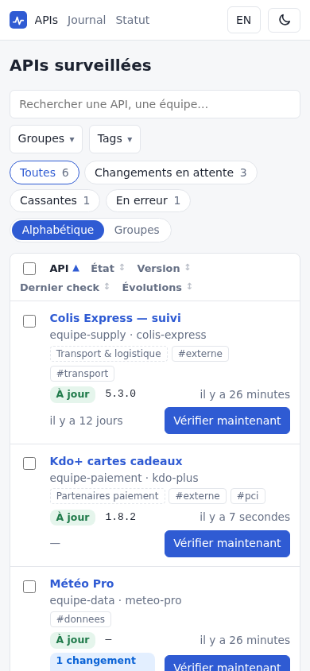 | 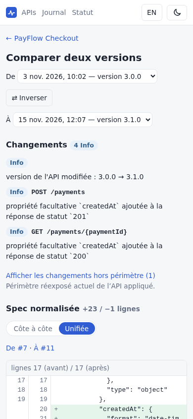 |
| **Sur mobile** : une carte par API, tri et filtres conservés, actions groupées en bas d'écran | … et un diff unifié, plus lisible qu'un côte à côte sur un écran étroit |

Les captures sont faites sur des APIs fictives servies en local (`scripts/screenshots/`), régénérables avec `task screenshots`.

## Configuration

Une API se déclare en quelques lignes dans `config/apis.yml` :

```yaml
apis:
  - id: payflow                    # clé stable : l'historique y est rattaché
    name: PayFlow Checkout
    group: paiement                # hérite de l'équipe, des tags, de l'intervalle et des notifications du groupe
    source:
      url: https://developers.payflow.example/docs/   # spec, ou page Swagger-UI / Redoc
      type: auto
    auth:
      type: oauth2_client_credentials
      token_url: https://auth.payflow.example/token
      client_id: kansabooj
      client_secret: ${PAYFLOW_SECRET}                # secrets par variable d'environnement ou fichier
    gateway:
      exposed_operations:          # ce que la Gateway réexpose : le reste est « hors périmètre »
        - POST /payments
        - GET /payments/{paymentId}
    ignore: [$.servers, $.info.description, $..example]   # $..x : la clé x à toute profondeur
```

Toutes les options sont décrites dans [`config/apis.example.yml`](config/apis.example.yml) et dans le JSON Schema [`config/apis.schema.json`](config/apis.schema.json). Pour tester une nouvelle source sans rien enregistrer : `kansabooj check --dry-run payflow`.

## Sécurité

- **Les secrets ne sont jamais écrits dans le YAML** : ils viennent de variables d'environnement ou de fichiers montés (`${VAR}`, `${file:/chemin}`), ne sont ni journalisés, ni stockés en base, ni renvoyés par l'API.
- **Les identifiants restent sur leur origine** : une redirection, une spec découverte ou un `$ref` vers un autre hôte est appelé sans authentification.
- **Contenu partenaire non fiable** : les scripts d'une page ne sont lus que sur le même hôte, les `$ref` externes ne sont suivis qu'en http(s) et en nombre limité, jamais vers un fichier local.
- **Anti-SSRF** : toutes les requêtes sortantes passent par un client unique (proxy d'entreprise, `deny_cidrs` / `allow_cidrs`) ; l'accès au réseau interne est un choix explicite par profil réseau.
- **API et interface** : jetons d'API par appelant (seule leur empreinte SHA-256 est configurée) avec des droits par usage (lecture, check, acquittement, validation, administration) ; derrière un reverse proxy SSO, l'utilisateur est repris de `X-Forwarded-User`. Aucune route ne modifie la configuration.
- Conteneur sans état, racine en lecture seule, utilisateur non root et UID arbitraire (OpenShift), NetworkPolicy fournie.

## Architecture

```
              config/apis.yml (Git, ConfigMap) ──▶ ┌──────────────── kansabooj serve ───────────────┐
                                                   │ scheduler (leader) ─▶ fetch ─▶ normalize ─▶ diff │──▶ webhooks
 navigateur ─▶ reverse proxy (SSO) ─▶ interface ──▶│ API REST /api/*        │ proxy d'entreprise      │   (Chat, Slack,
 CI ─────────────────────────(jeton)─────────────▶ │ /metrics               ▼                         │    Teams…)
                                                   └──────────┬──── APIs partenaires / internes ─────┘
                                                              ▼
                                                   PostgreSQL (état + historique)
```

Un seul binaire Go embarque l'interface React. Le diff sémantique vient d'[oasdiff](https://github.com/oasdiff/oasdiff), le parsing de [kin-openapi](https://github.com/getkin/kin-openapi). PostgreSQL en production, SQLite pour un essai local ou la CLI. Les choix et leurs raisons sont détaillés dans [l'architecture](docs/ARCHITECTURE.md) et les [ADR](docs/adr/).

## Démarrage rapide

Il faut Go 1.26, Node 22 et [Task](https://taskfile.dev).

```bash
git clone https://git.k3nny.fr/k3nny/kansabooj && cd kansabooj
task build                                             # interface + binaire bin/kansabooj
./bin/kansabooj serve --config config/apis.demo.yml    # http://localhost:8080, base SQLite dans data/
```

La configuration de démo surveille deux APIs publiques, sans secret. Essai complet avec PostgreSQL, depuis les sources : `docker compose -f deploy/compose.yaml up --build`.

## Déploiement

### Kubernetes / OpenShift

```bash
kubectl apply -k deploy/kubernetes/overlays/openshift    # ou overlays/kubernetes (Ingress)
```

Il faut une base PostgreSQL 12 ou plus (exemple CloudNativePG fourni), un Secret pour les webhooks et les identifiants partenaires, et la configuration en ConfigMap, rechargée à chaud quand elle change. Plusieurs réplicas peuvent tourner : un seul planifie les checks. Base gérée par une équipe DBA sur un serveur tiers : overlay `openshift-external-db`, voir [le guide](docs/guides/postgresql-externe.md).

### Docker Compose

Pour un serveur unique, sans Kubernetes : Kansabooj et PostgreSQL, secrets dans un fichier `.env`, configuration montée et rechargée à chaud.

```bash
cp -r deploy/compose /opt/kansabooj && cd /opt/kansabooj
cp .env.example .env && chmod 600 .env    # mot de passe de la base, webhooks, clés partenaires
docker compose up -d                      # interface sur 127.0.0.1:8080, à publier derrière un reverse proxy
```

Secrets, reverse proxy et SSO, mises à jour, sauvegardes : [guide Docker Compose](docs/guides/docker-compose.md).

## Utilisation en CI

```bash
kansabooj diff --fail-on error kansabooj:referentiel-clients build/openapi.yaml
```

Compare la spec d'un build à la dernière version connue par le serveur, avec son périmètre réexposé et ses règles anti-bruit : code retour `1` si une rupture touche le périmètre. Un dépôt de configuration peut aussi faire valider chaque fragment d'équipe par le serveur avant merge. Exemples GitLab CI et GitHub Actions dans [le guide CI](docs/guides/ci.md).

## Développement

```bash
task --list                       # toutes les tâches
task serve                        # API + scheduler sur :8080
task ui:dev                       # interface Vite sur :5173 (proxy /api vers :8080)
task test                         # tests Go (SQLite) avec -race + typecheck du front
task test:pg PG=postgres://…      # même suite sur PostgreSQL
task ci                           # rejoue la CI Gitea Actions en local
task screenshots                  # captures de docs/images
```

Les tests n'appellent jamais le réseau. Conventions et principes du projet : [CLAUDE.md](CLAUDE.md).

## Documentation

- [Architecture](docs/ARCHITECTURE.md) : besoin, choix techniques, normalisation, découverte, sécurité, marché
- [Feuille de route](docs/ROADMAP.md) et [décisions d'architecture](docs/adr/)
- [Docker Compose](docs/guides/docker-compose.md) : déploiement sur un serveur unique, reverse proxy, mises à jour, sauvegardes
- [PostgreSQL externe](docs/guides/postgresql-externe.md) : serveur tiers, TLS, comptes et schéma dédiés, migrations séparées
- [CI](docs/guides/ci.md) : validation des fragments de configuration, contrôle de contrat avant déploiement
- [Exploitation](docs/guides/exploitation.md) : métriques Prometheus, alertes proposées
- [API REST](backend/internal/httpapi/openapi.yaml) : servie aussi par `GET /api/openapi.yaml`

## Limites

- Le **mode dégradé HTML** signale qu'une page a changé, sans dire si le contrat est cassé : la vérification reste manuelle.
- La découverte ne lit que la configuration visible de la page et de ses scripts du même hôte ; une page entièrement construite côté client peut demander de donner l'URL de la spec directement.
- Les changements enregistrés avant la v0.6 n'ont que leur libellé d'origine (anglais pour ceux d'oasdiff).
- La vue côte à côte s'arrête au-delà de 2000 lignes modifiées entre deux versions : les deux specs normalisées restent téléchargeables.
- Formats non couverts : AsyncAPI, GraphQL, WSDL.

## Licence

Code sous licence [MIT](LICENSE).
